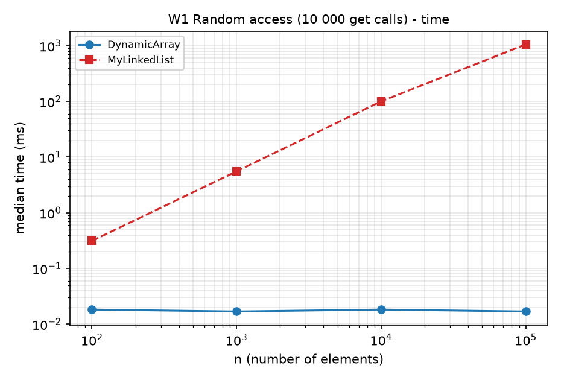
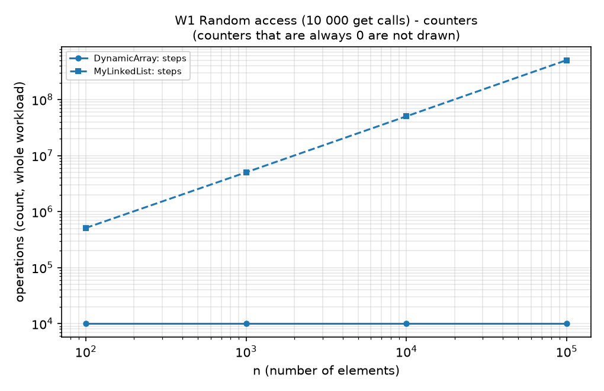
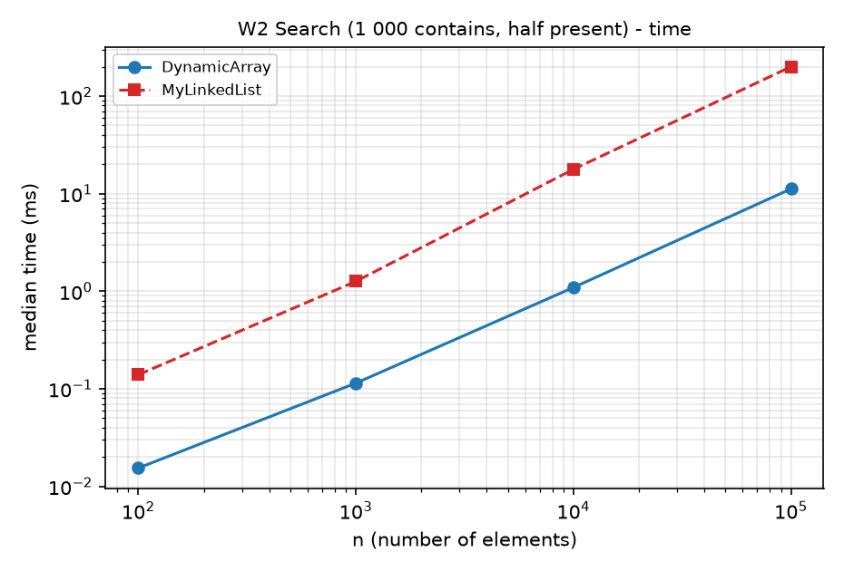
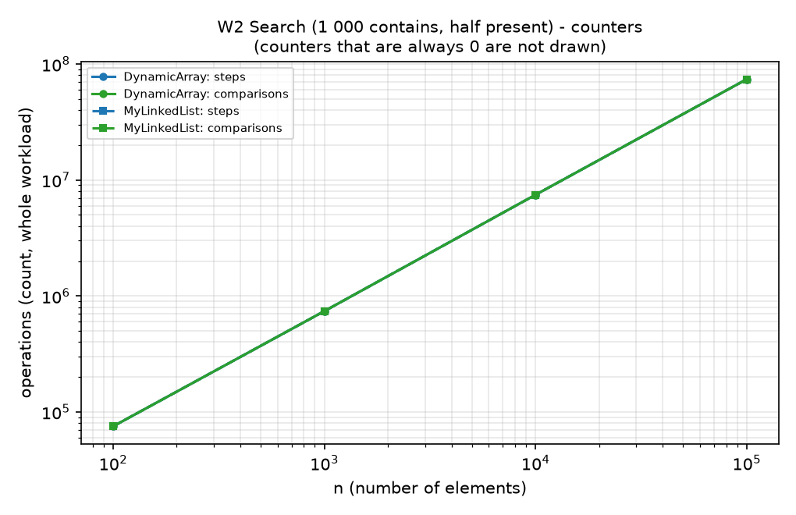
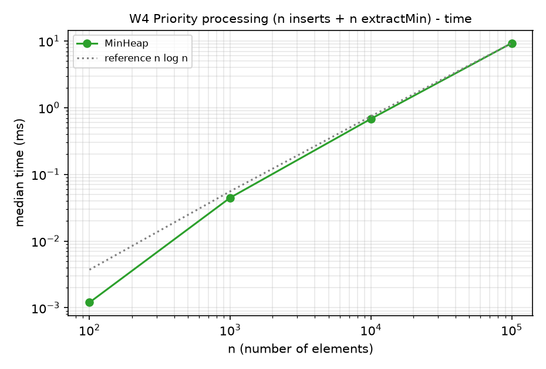
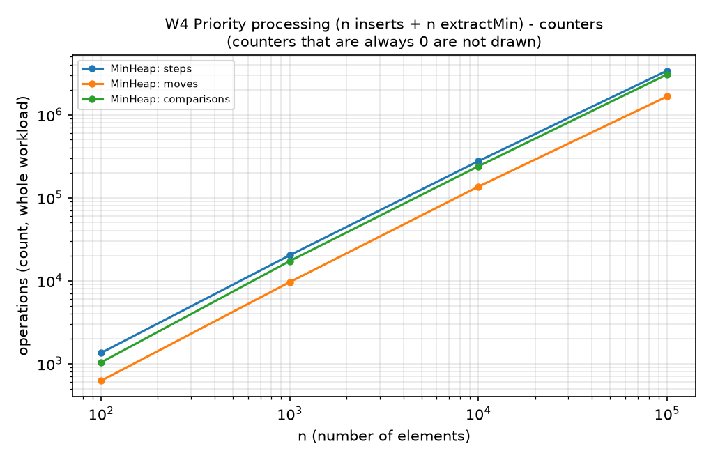
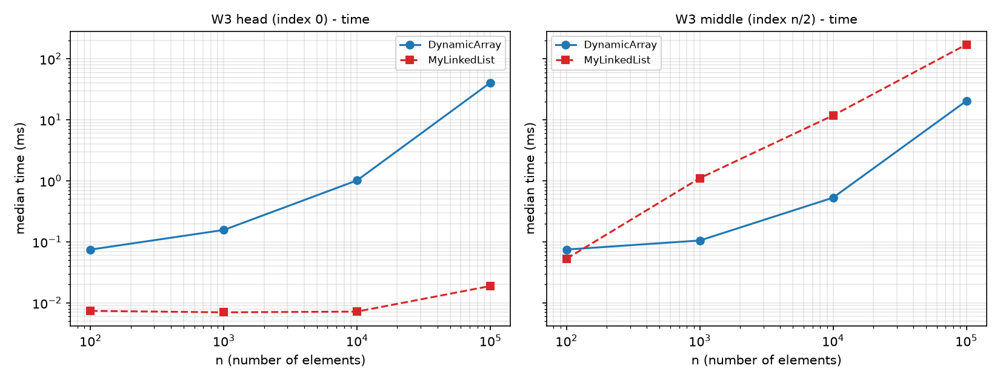
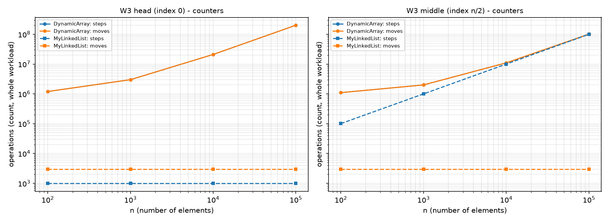

# Assignment 2 - Data Structures: Report

Design and Analysis of Algorithms - In-Memory Workload Engine

All three structures (`DynamicArray`, `MyLinkedList`, `MinHeap`) store primitive `int` values and are written from scratch. Counters are incremented inside the methods:

- **steps**: one array cell read, or one list node visited;
- **moves**: one element shifted/copied in an array, or one link (pointer) update in a list;
- **comparisons**: one comparison of two stored elements.

Array growth (2x) counts every copied element as one step and one move. In W1-W3 only the operation phase is timed and counted (filling happens before the counters are reset); W4 counts the inserts and the extractMin calls together.

Environment of the reported run: 12th Gen intel(R) Code(TM) i5-12450H, Java 24.0.2, `-Xms512m -Xmx512m`, `new Random(42)`, 5 discarded warm-up runs plus a global JIT warm-up, then the median of 5 measured runs. Counters are deterministic; times depend on the machine.

## 1. Complexity table

Notation: n = current size. `MyLinkedList` is singly linked with head and tail pointers. Auxiliary space is the extra memory one call needs; the structures themselves take Θ(n) space (array: between n and 2n int cells; list: n nodes of about 24 bytes; heap: between n and 2n cells).

| Structure | Operation | Best | Average | Worst | Aux. space | Justification |
|---|---|---|---|---|---|---|
| DynamicArray | add(x) | Θ(1) | Θ(1) amortized | Θ(n) | O(1); Θ(n) on resize | Doubling copies at most 2n elements over n adds; the single add that triggers a resize copies n. |
| DynamicArray | add(index, x) | Θ(1) | Θ(n) | Θ(n) | O(1); Θ(n) on resize | index = size shifts nothing; a random index shifts about n/2 elements; index 0 shifts n. |
| DynamicArray | remove(index) | Θ(1) | Θ(n) | Θ(n) | O(1) | Removing the last element shifts nothing; a random index shifts about n/2; index 0 shifts n-1. |
| DynamicArray | get(index) | Θ(1) | Θ(1) | Θ(1) | O(1) | One indexed read. |
| DynamicArray | contains(x) | Θ(1) | Θ(n) | Θ(n) | O(1) | Best: x is in cell 0. Absent x scans all n cells; a uniformly placed x scans about n/2. |
| MyLinkedList | add(x) | Θ(1) | Θ(1) | Θ(1) | O(1) | The tail pointer gives the last node directly: two link updates. |
| MyLinkedList | add(index, x) | Θ(1) | Θ(n) | Θ(n) | O(1) | index 0 or size needs no traversal; otherwise the predecessor is reached after index node visits (up to n-1). |
| MyLinkedList | remove(index) | Θ(1) | Θ(n) | Θ(n) | O(1) | index 0 is O(1); every other index needs a walk to the predecessor, even the last (singly linked). |
| MyLinkedList | get(index) | Θ(1) | Θ(n) | Θ(n) | O(1) | index 0 is the head; otherwise index+1 node visits (about n/2 on average). |
| MyLinkedList | contains(x) | Θ(1) | Θ(n) | Θ(n) | O(1) | Best: x is in the head. Absent x visits all n nodes. |
| MinHeap | insert(x) | Θ(1) | Θ(1) on random input | Θ(log n); Θ(n) with resize | O(1); Θ(n) on resize | Best: x >= parent. Worst: x is a new minimum and climbs to the root (height ⌊log2 n⌋). On random input the climb is short on average. |
| MinHeap | peekMin() | Θ(1) | Θ(1) | Θ(1) | O(1) | Reads a[0]. |
| MinHeap | extractMin() | Θ(1) | Θ(log n) | Θ(log n) | O(1) | Best: all keys equal, the moved last element stops at once. Usually the last element is large and sinks almost to the bottom (about 28 comparisons per call at n = 100 000, measured in W4). |

## 2. Loop invariant proofs

### 2.1 `DynamicArray.contains(x)`

```java
for (int i = 0; i < size; i++) {
        if (data[i] == x) { found = true; break; }
        }
```

- **Invariant:** at the start of every iteration (and when the condition `i < size` is tested), 0 <= i <= size and x does not occur in `data[0..i-1]`.
- **Initialization:** before the first iteration i = 0, so `data[0..-1]` is empty and contains no x. The invariant holds trivially.
- **Maintenance:** assume the invariant holds at the start of an iteration with i < size. If `data[i] == x` the loop exits through `break` (this case is handled in termination). Otherwise `data[i] != x`, so x does not occur in `data[0..i]`; after `i++` this says that x is not in `data[0..i'-1]` for the new i' = i + 1 <= size. The invariant holds again.
- **Termination:** the loop stops in one of two ways. (a) `break` at index i: then `data[i] == x`, so x is present and `found = true` is correct. (b) The condition fails, i = size: the invariant gives that x does not occur in `data[0..size-1]`, which is the whole array, so `found = false` is correct. i grows by 1 per iteration and is bounded by size, so the loop ends.
- **Conclusion:** in both exits the returned value equals "x is in the array", so contains is correct. The invariant is what rules out a wrong `false` result: when the loop ends without a hit, every cell has already been checked.

### 2.2 `MinHeap.siftDown` (bubble-down used by `extractMin`)

```java
int i = start;                           // start = 0 for extractMin; n = size after the removal
while (true) {
int c = 2 * i + 1;
    if (c >= n) break;                   // i has no children
int cv = a[c];
    if (c + 1 < n && a[c + 1] < cv) { c++; cv = a[c]; }   // c = smaller child
        if (x <= cv) break;                  // x fits here
a[i] = cv;  i = c;                   // smaller child moves up, hole moves down
}
a[i] = x;
```

Setting for `extractMin`: the old minimum was taken out, the last element was removed and kept in `x`, and positions 0..n-1 remain, where position 0 is a hole (a stale value that is not part of the heap). Before the loop, every tree edge (p, c) with c < n and p != 0 satisfies a[p] <= a[c] (these edges were already valid in the old heap). Call a pair (p, c) with c = 2p+1 or 2p+2 an *edge*.

- **Invariant** (before each iteration, hole at position i):
    - (I1) every edge (p, c) with c < n, p != i and c != i satisfies a[p] <= a[c];
    - (I2) if i > 0, then a[parent(i)] <= x and a[parent(i)] <= a[c] for every child c of i.
- **Initialization:** i = 0. Edges with p != 0 satisfy (I1) by the setting; edges that touch position 0 are excluded. (I2) is vacuous because i = 0.
- **Maintenance:** assume the invariant holds at the start of an iteration that does not exit. Let m be the smaller child of i and cv = a[m]; we are in the case x > cv. The body sets a[i] = cv and the hole moves to m.
    - (I1) for the new hole m: take an edge (p, c) with p != m and c != m. If p = i, then c is the sibling of m and a[i] = cv <= a[c] because m is the smaller child. If c = i, the edge is (parent(i), i): the new a[i] equals cv, and a[parent(i)] <= cv holds by (I2). All other edges are unchanged and were valid by the old (I1).
    - (I2) for the new hole m, whose parent is i: a[i] = cv < x, and for every child c' of m the edge (m, c') had p = m != i, so the old (I1) gives cv = a[m] <= a[c'], i.e. a[i] <= a[c'].
- **Termination:** each iteration moves i to a child, so i strictly increases and stays below n; the loop ends after at most ⌊log2 n⌋ iterations, either because i has no child or because x <= cv. Then `a[i] = x` fills the hole. The edge (parent(i), i) is valid by (I2). The edges (i, children) are valid: there are none in the first case, and in the second x <= cv <= the other child. All remaining edges are valid by (I1).
- **Conclusion:** after the loop every edge satisfies a[parent] <= a[child], so positions 0..n-1 form a valid min-heap that contains exactly the old elements without the extracted minimum. This proves that `extractMin` returns the minimum and keeps the heap property.

## 3. Benchmark results

Full data is in `results/results.csv` (columns `workload,variant,structure,n,time_ms,steps,moves,comparisons`). Charts are in `results/plots/`; both axes are logarithmic and counters that are always zero cannot be drawn on a log axis. In the counter charts the steps and moves curves of `DynamicArray` coincide in W3 because every shifted element costs one read and one move.

| Workload | Time vs n | Steps / moves / comparisons vs n |
|---|---|---|
| W1 Random access |  |  |
| W2 Search |  |  |
| W4 Priority processing |  |  |

W3 Insert & Remove (left: head, right: middle):





Key measurements at n = 100 000:

| Workload | DynamicArray | MyLinkedList |
|---|---|---|
| W1 get x 10 000 | 0.017 ms, 10 000 steps | 1056.5 ms, 504 940 938 steps |
| W2 contains x 1 000 | 11.2 ms, 73 970 266 steps | 200.1 ms, 73 970 266 steps |
| W3 head | 40.7 ms, 200 999 000 moves | 0.019 ms, 3 000 moves, 1 000 steps |
| W3 middle | 20.4 ms, 100 999 000 moves | 171.1 ms, 100 001 000 steps, 3 000 moves |
| W4 (MinHeap) | 9.3 ms, 3 059 125 comparisons, 1 659 236 moves | - |

(1) `DynamicArray.get(i)` reads one cell, so W1 costs exactly 10 000 steps for every n and only about 0.017 ms at n = 100 000, while `MyLinkedList.get(i)` must walk i+1 nodes: 505 million steps and 1056.5 ms at n = 100 000, about 62 500 times slower. (2) Equal step counts do not mean equal time: in W2 both structures perform exactly 73 970 266 steps and comparisons at n = 100 000, yet the array needs 11.2 ms and the list 200.1 ms, so a step costs about 0.15 ns in the array and 2.71 ns in the list. (3) The array is faster because of spatial locality: its ints are contiguous, one 64-byte cache line holds 16 of them, the hardware prefetcher recognises the sequential scan, the CPU can keep many loads in flight, and the JIT can unroll the loop. (4) A list node is a separate object (a 12-byte header plus the value and a reference, about 24 bytes after alignment), so a cache line holds fewer than three nodes and consecutive nodes are not guaranteed to be neighbours in memory. (5) Following `next` is pointer chasing: the address of the next node is known only after the previous load finishes, so loads are serialised and every cache miss costs a full memory latency. (6) W3 middle shows the same effect: the array shifts 101 million elements and the list visits 100 million nodes, yet the array finishes in 20.4 ms and the list in 171.1 ms, because the shift is a sequential copy that the JIT turns into wide moves (about 5.0 elements per ns) while traversal runs at about 0.58 nodes per ns. (7) The list also has a larger memory footprint and creates one object per add that the garbage collector must trace and later reclaim, whereas the array allocates only when it doubles (we did not measure GC time separately, so this is an explanation, not a measurement). (8) `MyLinkedList` is the better choice for insertions and removals at the head or tail, where the position is known: in W3 head it needs 1 000 steps and 3 000 link updates for every n and takes 0.019 ms, while the array shifts 201 million elements and needs 40.7 ms at n = 100 000. (9) That advantage disappears when the position must first be found by traversal, as W3 middle shows (the list is 8.4 times slower), so a list pays off only for operations at its ends or at a node that is already held. (10) `MinHeap` is the better choice for priority processing: W4 needs about 3.1 million comparisons for 100 000 inserts and 100 000 extractMin calls (about 1.8 · n log2 n), whereas a sorted array or list costs Θ(n) per insertion and an unsorted one costs Θ(n) per extractMin. (11) The price is that a heap gives cheap access only to the minimum, with no indexed access, search or sorted iteration. (12) In short, equal Big-O describes only how the operation count grows; memory layout decides the constant, and in W2 that constant is a factor of about 18 for equal step counts.